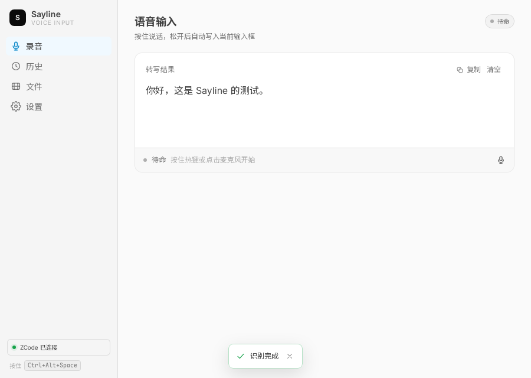
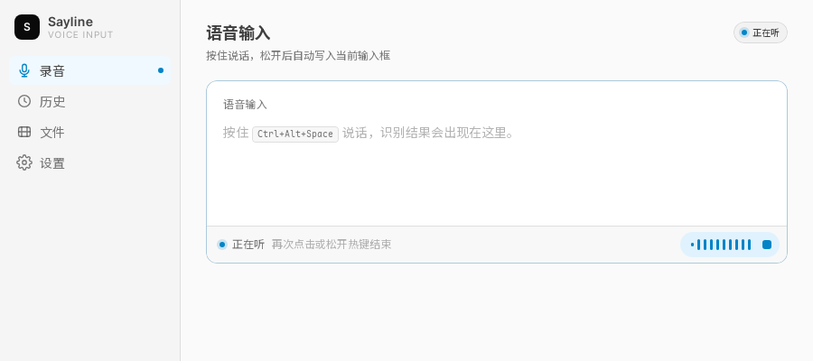
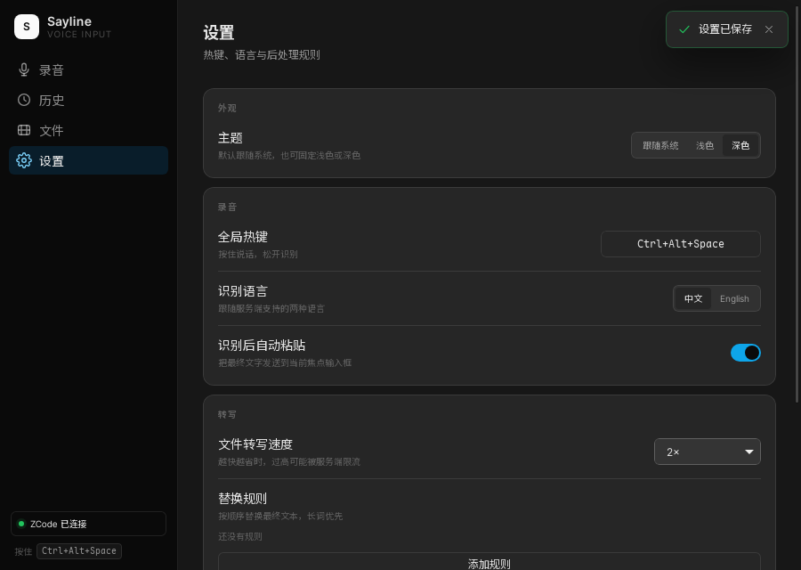

# Sayline

[](LICENSE)
[](#)
[](#已知边界)
[](https://tauri.app)
[](https://www.rust-lang.org)
[](https://react.dev)

Sayline 是一个独立的 Linux 桌面语音输入小工具。按住全局热键说话，松开后把识别文字自动粘贴到当前输入框。它复用本机 ZCode 桌面端的登录态和 ASR 服务，不修改 ZCode 安装。

> [!WARNING]
> Sayline 是非官方项目，与 Z.ai 无关联，也未获其授权或背书。
> 它读取本机已登录 ZCode 的凭据，并直接调用 ZCode 的 ASR 接口。
> ZCode 用户协议禁止反向工程、绕过安全措施、冒充客户端，以及传播规避方法。
> 公开使用或分发本工具可能违反该协议，并导致 ZCode 账号被限流、冻结或封禁。
> 仅在你理解并自行承担这些风险时使用。本项目不提供任何担保。

状态：alpha。仅支持 X11；Wayland 未支持；托盘未在真实桌面验收；中文语音未真机验证。



界面按 ZCode 的 `packages/ui/src/voice-input/ui/VoiceInputControls.tsx` 设计语言实现：录音胶囊使用 sky 专用 token、10 根 3 px 波形、28 px 控件与 12 px 卡片圆角；支持跟随系统、浅色和深色主题。

## 功能

- 按住 `Ctrl+Alt+Space` 说话，松开即识别。
- 悬浮胶囊显示录音状态和 10 段音量波形，不抢输入框焦点。
- 识别完成后自动复制并粘贴到当前焦点应用；也可在界面里手动复制。
- 历史记录保存在本机 SQLite，可搜索、复制、删除，导出 Markdown / JSON。
- 音频文件转写：拖入或选择 wav / mp3 / flac / ogg / m4a / aac。
- 替换规则、中文 / English 识别语言、热键与服务地址可配置。
- 浅色 / 深色 / 跟随系统主题。
- 托盘入口：显示主窗口、开始 / 停止录音、退出。

## 依赖

- Linux X11 桌面（全局热键与自动粘贴依赖 X11；Wayland 未验证）。
- 已安装并登录 ZCode 桌面端（读取 `~/.zcode/v2/credentials.json` 与系统 keyring）。
- 录音后端之一：`parec`（PulseAudio / PipeWire）、`pw-record`（PipeWire）、`arecord`（ALSA）。
- 自动粘贴需要 `xdotool`。

## 构建与运行

开发模式（自动启动 Vite）：

```bash
cd impl
pnpm install
pnpm tauri dev
```

打包 deb：

```bash
cd impl
pnpm tauri build --bundles deb
```

产物在 `impl/src-tauri/target/release/bundle/deb/`，安装：

```bash
sudo dpkg -i impl/src-tauri/target/release/bundle/deb/Sayline_*.deb
```

卸载：

```bash
sudo dpkg -r sayline
```

Linux 构建依赖：`libwebkit2gtk-4.1-dev`、`libgtk-3-dev`、`librsvg2-dev`、
`libayatana-appindicator3-dev`、`patchelf`、`dpkg-deb`。

## 使用

1. 打开 ZCode 桌面端并完成登录。
2. 启动 Sayline。左侧显示「ZCode 已连接」表示登录态读取成功。
3. 在任意应用中按住 `Ctrl+Alt+Space` 说话，松开后文字会粘贴到当前焦点输入框。
4. 设置页可改热键、语言、自动粘贴、主题、替换规则和文件转写速度。

录音中的界面：



深色主题：



配置路径：`~/.config/sayline/settings.json`。历史库：`~/.local/share/sayline/history.db`。

## 项目结构

```text
sayline/
├── impl/                 # Tauri 应用（React + Rust）
│   ├── src/              # React 页面、组件、事件与样式
│   └── src-tauri/        # Rust：凭据、录音、ASR、历史、托盘
├── spec/                 # ASR 协议与功能清单
├── docs/
│   ├── agents/           # 架构、验证、方法循环、交接上下文
│   ├── evidence/         # 界面截图
│   └── method/           # 净室方法说明
├── tools/                # 本地 ASR mock、粘贴目标窗口
├── log/devlog.md         # 每轮变更与未决项
└── HANDOFF.md            # 下一个会话的最短上下文
```

开发与交接说明见 `HANDOFF.md`、`docs/agents/architecture.md`。

## 数据与隐私

- 录音以 16 kHz 单声道 PCM16 流式发往 ZCode 的 ASR 服务（默认 `https://zcode.z.ai`），由服务端选择上游 provider。
- 音频会到达 ZCode 及其上游 ASR 提供方；服务端是否留存、留存多久由它们决定，Sayline 无法控制，也不承诺音频不会被留存。
- Sayline 不保存音频；历史库只保存识别文本和时长。
- 识别文本会写入系统剪贴板，并在自动粘贴期间保留约 120 秒；其他应用可能读取剪贴板。
- 历史库以明文 SQLite 保存在本机；可在历史页删除单条或清空全部。
- 日志不记录识别文本、音频、ticket 或 JWT。
- 自动粘贴通过 X11 剪贴板与 `xdotool` 完成，不经过 shell。

## 已知边界

- 只支持 X11；Wayland 下全局热键与模拟粘贴不可用。
- 悬浮胶囊的透明背景依赖桌面合成器；无合成器的 Xvfb 下会显示黑色底色。
- 识别语言跟随 ZCode ASR 支持范围：`zh-CN` / `en-US`。
- 文件转写按实时节奏分块发送，速度可调到 4×；服务端仍可能限流。
- ZCode 凭据格式随版本变化；读取失败时请先重启并重新登录 ZCode。
- 原生文件选择框在部分无窗口管理器的环境下表现异常；文件页提供路径输入作为回退。

## 风险与合规

- 本项目不是 Z.ai 官方客户端，未获授权或背书。
- [ZCode 用户协议](https://zcode.z.ai/cn/terms)限制反向工程、绕过安全措施、冒充客户端和传播规避方法；本工具直接调用 ASR 接口的方式可能与这些条款冲突。
- 使用本工具可能使你的 ZCode 账号被限流、冻结或封禁；作者不承担由此产生的损失。
- 如果你不同意这些风险，请不要使用或分发本项目。

## 发布形态

本仓库只发布源码，不发布预编译二进制。需要安装包时，请按上面的构建步骤在本机生成。

## 来源与许可

Sayline 的语音输入协议、状态机与交互设计参考了开源项目
[ZCode](https://github.com/zai-org/ZCode)（Apache-2.0）。本仓库以自己的 Rust / React
实现重写，未包含 ZCode 的 Electron 运行时。详见 `NOTICE` 与 `LICENSE`。

ZCode 的代码按其 Apache-2.0 许可提供；该许可不授权 ZCode 的 ASR 服务，也不改变
ZCode 用户协议对服务使用的限制。ZCode 是 Z.ai 的商标，本项目仅作事实性指称。

## 贡献

这是一个 alpha 项目。提交 issue 前请先读 `HANDOFF.md` 与 `AGENTS.md`；涉及 ZCode
服务端行为的问题请附上可复现步骤和错误码。不要粘贴 token、ticket、音频或识别文本。
