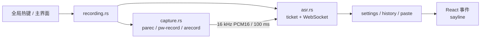

# 架构与实现

## 数据流



## 进程与模块

| 模块 | 职责 |
| --- | --- |
| `lib.rs` | Tauri Builder、状态注入、托盘、关闭到托盘、命令注册 |
| `state.rs` | `AppState`：设置、历史、当前录音、当前文件任务、热键 sender、HTTP client |
| `recording.rs` | 麦克风会话编排、悬浮层显示/定位、attempt 生命周期 |
| `capture.rs` | 探测系统录音命令，读取 PCM16，切 100 ms 块并统计峰值 |
| `asr.rs` | ticket、WebSocket、`start`/`finish`/`cancel`、事件映射、文本收尾 |
| `credentials.rs` | 读取 ZCode 凭据容器，keyring 主密钥，AES-256-GCM 解密 |
| `file_decode.rs` | symphonia 解码音频为单声道 f32，线性重采样到 16 kHz |
| `file_job.rs` | 文件转写任务、进度、节奏发送、取消 |
| `history.rs` | SQLite 表 `transcripts`、搜索、删除、导出 |
| `settings.rs` | `settings.json`、替换规则、默认值、主题校验 |
| `paste.rs` | X11 剪贴板 + `xdotool ctrl+v`；剪贴板保持 owner |
| `hotkey.rs` | `global-hotkey` 线程，按住开始/松开结束，热键重注册 |
| `tray.rs` | 托盘菜单；失败时关闭窗口直接退出 |
| `events.rs` | 统一 `sayline` 事件类型 |
| `commands.rs` | Tauri 命令面 |

前端：

| 文件 | 职责 |
| --- | --- |
| `App.tsx` | 页面切换、事件归并、主题应用、录音状态机 UI |
| `views/RecordView.tsx` | ZCode composer 式语音控制台 |
| `views/HistoryView.tsx` | 搜索/复制/删除/导出 |
| `views/FilesView.tsx` | 拖放、文件选择、路径输入、进度 |
| `views/SettingsView.tsx` | 热键/语言/主题/替换/服务地址 |
| `Overlay.tsx` | 悬浮胶囊，独立窗口 |
| `components/Waveform.tsx` | 10 根波形，3–14 px |
| `styles.css` | ZCode 语义 token、浅/深色、全部组件样式 |

## 状态机

```text
idle ──热键/点击──▶ requesting ──started──▶ recording ──松开/点击──▶ finishing ──completed──▶ idle
  ▲                     │                       │
  └──── error/cancel ───┴───────────────────────┘
```

- 每次录音一个 `attemptId`；旧 attempt 的事件直接丢弃。
- `requesting` 之前/期间清空上一轮预览文本。
- 用户松开热键或再次点击：停止采集，flush 尾块，发送 `finish`。
- 错误、取消、失败：回到 idle；历史只在 `completed` 且文本非空时写入。
- 文件转写独立 `source=file`，不影响麦克风状态。

## 事件契约

```ts
type SaylineEvent =
  | { event: "state"; state: "idle"|"requesting"|"recording"|"finishing"; source: "mic"|"file" }
  | { event: "level"; level: number; source: string }       // 0..1，-50..-10 dBFS 映射
  | { event: "partial"; text: string; source: string }
  | { event: "final"; text: string; source: string; item: HistoryItem|null }
  | { event: "error"; message: string; source: string; code: string }
  | { event: "progress"; percent: number; source: string };
```

- 事件名：`sayline`。
- 主题事件：`sayline-theme`，payload `light` / `dark`。
- 前端只在 `App.tsx` 和 `Overlay.tsx` 各注册一次监听。

## 设计系统

- 参考 `zai-org/ZCode` 的 `VoiceInputControls.tsx` 与 `styles.css`。
- 语音胶囊专用 token，不用于其他组件：
  - `--voice-input-surface`：浅 `#e0f2fe` / 深 `#082f49`
  - `--voice-input-wave`：浅 `#0284c7` / 深 `#7dd3fc`
- 波形：10 根、3 px、4 px 间距、3–14 px；28 px 控件；10 px 停止方块。
- 通用 token：`--background`、`--card`、`--popover`、`--input`、`--border`、
  `--foreground*`、`--primary`、`--brand`；卡片 12 px 圆角。
- 字号：`--text-ui-xl` 18 / `lg` 16 / `base` 14 / `caption` 13 / `sm` 12 / `xs` 10。

## 外部协议

完整规格见 `spec/asr-protocol.md`。核心：

- `POST /api/v1/asr/tickets`：Bearer JWT，body `{"mode":"realtime"}`，返回
  `ticket` + `ws_path`。
- WebSocket `?ticket=`，首帧 `start` 声明 `pcm_s16le / 16000 / 1`，
  之后二进制 PCM，结束 `finish`，取消 `cancel`。
- 服务端事件：`started` / `result` / `completed` / `error` / `cancelled`。
- `result` 是完整快照，不是增量。
